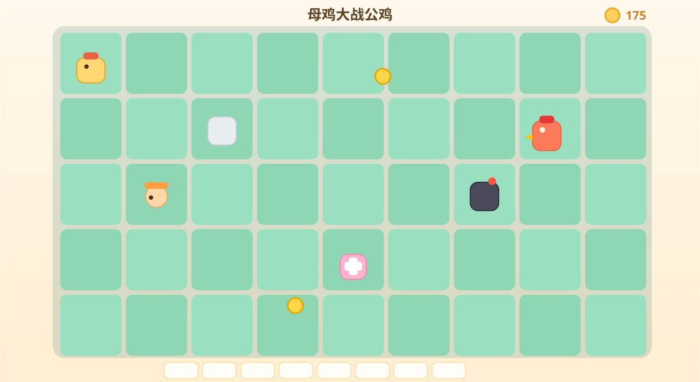

# 母鸡大战公鸡

**休闲塔防小游戏 —— 放置母鸡单位，收集玉米粒，抵御公鸡进攻，守护鸡窝基地。**

👆 点上面这颗蓝色按钮，浏览器直接开玩，不用下载、不用登录

---

## 🐣 项目速览

| 🛡️ 塔防 | 🌿 休闲 | 🧠 策略 | 📱 手机竖屏 |
| :--: | :--: | :--: | :--: |
| 5×9 草坪布阵 左边鸡窝、右边出兵口 | 一局三分钟 随时开、随时走 | 8 种单位搭配 经济与站位的取舍 | 竖屏单手可玩 底部卡牌、中间战场 |

---

## 🖼 游戏画面

> 上方信息栏（波次 / 玉米粒） · 中间 5×9 战场 · 底部 8 张单位卡牌。

---

## 🎮 怎么玩

1. **捡玉米粒**：开局 50 玉米粒，天上会掉、母鸡会下，点一下 +25。
2. **放单位**：点底部卡牌选中，再点草坪格子放置。
3. **守住鸡窝**：公鸡从右侧一波波冲过来，走到最左边会开始啃基地。
4. **一波清空**：场上公鸡清光且待刷队列空 → 进入 15 秒准备，再打下一波。

**撑过 5 波就是胜利。**

---

## 🐔 八种单位

| 单位 | 造价 | 血量 | 作用 |
| :-- | --: | --: | :-- |
| 🟡 **母鸡** | 50 | 320 | 每 5 秒下一颗玉米粒，经济核心 |
| 🟠 **小鸡狙击手** | 100 | 220 | 同行有敌就开火，1.2 秒一发 26 伤害 |
| ⬜ **石头蛋** | 50 | 1500 | 纯肉盾，站着挨啄换输出时间 |
| 🔵 **冲锋小鸡** | 60 | 150 | 放下即向前冲 1 格，撞到第一只公鸡打 120 后自毁 |
| 💗 **治愈母鸡** | 120 | 280 | 不攻击，每 3 秒给周围 8 格友军回 10 血 |
| 💣 **炸弹小鸡** | 130 | 200 | 静默陷阱，公鸡贴脸引爆，3×3 范围 140 伤害 |
| 🟢 **高速连发鸡** | 75 | 200 | 0.6 秒一发 10 伤害，只打前方 3 格 |
| 🟣 **重甲反伤母鸡** | 150 | 3000 | 极厚血，被啃时反弹 25 伤害给公鸡 |

---

## 🐓 敌人与波次

| 敌人 | 血量 | 速度 | 特点 |
| :-- | --: | --: | :-- |
| 大公鸡 | 260 | 26 | 基准杂兵 |
| 突袭公鸡 | 150 | 39 | 1.5 倍速快攻，血薄 |
| 巨型公鸡 | 900 | 12 | 体型 1.5 倍，每啃 3 口放一次 3×3 震慑 |

| 波次 | 普通 | 突袭 | 巨型 | 刷新间隔 |
| :-- | --: | --: | --: | --: |
| 第 1 波 | 5 | – | – | 4.0s |
| 第 2 波 | 8 | 2 | – | 3.5s |
| 第 3 波 | 10 | 4 | – | 3.0s |
| 第 4 波 | 12 | 6 | 1 | 2.5s |
| 第 5 波 · BOSS | 15 | 8 | 2 | 2.0s |

---

## 🔧 自带调试后台

右下角 **⚙** 点开：暂停 / 继续、手动刷公鸡、修改玉米粒、清空场上单位、战斗日志，方便调平衡和复现问题。

---

## ⚙️ 技术说明

| 项 | 说明 |
| :-- | :-- |
| 结构 | 单个 HTML 文件，内联 CSS + 纯 JS，无构建步骤 |
| 引擎 | Phaser 3.80.1，本地 `phaser.min.js` 优先，CDN 兜底 |
| 美术 | 全色块 / SVG 绘制，零位图素材 |
| 适配 | 1280×672 画布 + `Scale.FIT`，横竖屏等比自适应 |

---

**Designed & Directed by CYRENE** · © 2024 CYRENE Studio · All Rights Reserved.

仓库名保留历史 `iron-tomb-brawl`，内容为《母鸡大战公鸡》

