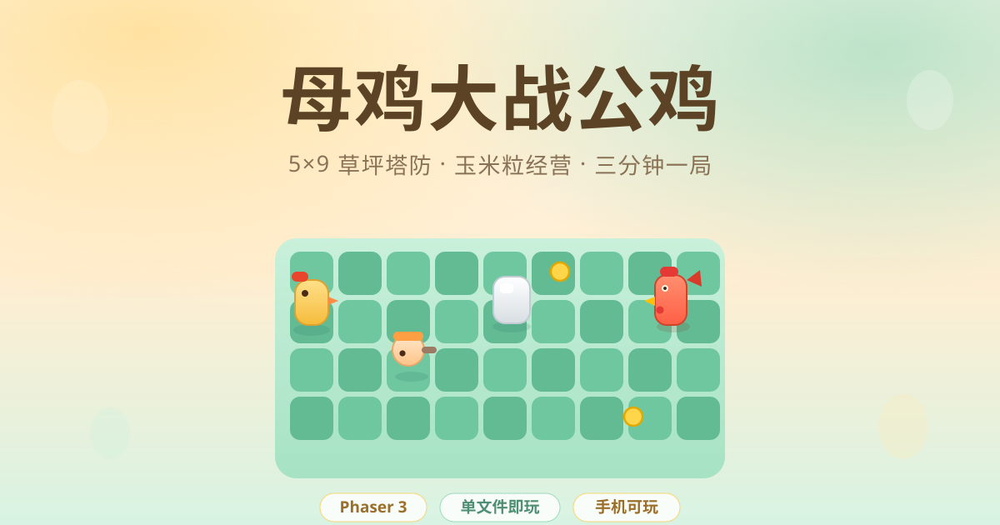

<div align="center">



# 🥚 母鸡大战公鸡

**把公鸡挡在鸡窝外面 —— 5×9 草坪塔防，攒玉米粒、孵蛋兵、三分钟一局。**

[![在线试玩][badge-play]][link-play]
[![Phaser][badge-phaser]][link-phaser]
[![手机可玩][badge-mobile]][link-play]
[![单文件][badge-single]][link-play]

</div>

---

## 🎮 立刻开玩

| 玩法 | 地址 |
| :-- | :-- |
| 🚀 在线试玩 | **<https://slildisn.github.io/egg-war/>** |
| 📄 游戏本体 | [`index.html`](./index.html) —— 单文件，双击即开 |

不用安装、不用登录、不用打包，**手机横竖屏都能玩**。

---

## ✨ 这是什么

左边是暖黄色的**鸡窝基地**，右边是橘红色的**公鸡出兵口**，中间 9 列 5 行草坪任你摆兵。

天上会掉玉米粒、母鸡会下蛋，捡起来换成兵；公鸡一波波从右边冲过来，谁先摸到鸡窝谁赢。

- 🌽 **玉米粒经济**：初始 50，捡一颗 +25，钱不够卡牌会变暗
- 🃏 **点卡放兵**：点左上角卡牌选中 → 点草坪格子放下
- 🐓 **压力递增**：每 5 秒随机一行刷一只公鸡，一直往左走
- 🪺 **一失守就结束**：公鸡走到最左边 → 游戏结束，点屏幕重开

---

## 🐔 三种蛋兵

| 单位 | 造价 | 血量 | 作用 |
| :-- | --: | --: | :-- |
| 🟡 **母鸡** | 50 | 320 | 每 5 秒在头顶下一颗玉米粒，是经济核心，先铺满前排回本 |
| 🟠 **小鸡狙击手** | 100 | 220 | 同一行前方有公鸡就自动开火，1.2 秒一发、26 点伤害 |
| ⬜ **石头蛋** | 50 | 1500 | 1500 血的纯肉盾，专门站在前面挨啄，给后排争取输出时间 |

---

## 🐓 敌人

| 属性 | 数值 |
| :-- | --: |
| 血量 | 260 |
| 移动速度 | 26 px / 秒 |
| 啄击伤害 | 30 / 次 · 每 0.9 秒 |
| 出兵间隔 | 5 秒 · 随机一行 |

公鸡撞上任何蛋都会停下来啄，蛋碎了才继续往前走；被子弹打空血就倒地消失。

---

## 🕹️ 操作

1. 点**卡牌**选中（金边 + 上浮）
2. 点**草坪格子**放置，划过的格子会高亮，被占用的会变红
3. 点**玉米粒**收取（+25，飞进右上角数字）
4. 公鸡摸到左边鸡窝 → 结束，点屏幕重开

---

## 🔧 自带调试后台

右下角 **⚙** 点开，写玩法/调数值时很好用：

- ⏸ **暂停 / 继续**（冻结刷怪、移动、子弹、掉落）
- 🦃 **手动刷公鸡**（绕过 5 秒计时器）
- 🌽 **修改玉米粒数量**（数字输入框）
- 🧹 **清空场上单位**（清掉所有蛋兵和空中子弹）
- 📜 **战斗日志**：刷怪、放置、命中、击杀、拾取，带时间戳，保留最近 60 条

---

## ⚙️ 技术说明

| 项 | 说明 |
| :-- | :-- |
| 结构 | **单个 HTML 文件**：内联 CSS + 纯 JS，没有构建步骤 |
| 引擎 | Phaser 3.80.1，加载顺序 `本地 phaser.min.js → unpkg → baomitu → staticfile → jsdelivr`，哪个通用哪个 |
| 美术 | **全部是色块图形**（矩形 / 圆 / 圆角矩形），零图片资源，仓库很轻 |
| 适配 | `Phaser.Scale.FIT` + 自动居中，1280×720 画布等比铺满任何屏幕 |
| 帧更新 | 单个 `update()` 手动积分，暂停只需跳过一帧，没有隐式定时器泄漏 |

---

## 📁 目录

```
index.html      游戏本体（HTML + CSS + JS 全在一个文件里）
phaser.min.js   Phaser 3.80.1 引擎（本地优先加载，断网也能跑）
docs/cover.svg  仓库封面图
README.md       本文件
```

---

## 📜 署名

**Designed & Directed by CYRENE** · © 2024 CYRENE Studio · All Rights Reserved.

角色、数值、玩法与代码归 CYRENE Studio 所有；本项目为原创同人作品，未使用第三方游戏引擎以外的任何库（Phaser 3 遵循 MIT）。

[badge-play]: https://img.shields.io/badge/%E5%9C%A8%E7%BA%BF%E8%AF%95%E7%8E%A9-egg--war-3ddc84?style=for-the-badge&logo=googlechrome&logoColor=white
[link-play]: https://slildisn.github.io/egg-war/
[badge-phaser]: https://img.shields.io/badge/Phaser-3.80.1-8a2be2?style=for-the-badge&logo=phaser&logoColor=white
[link-phaser]: https://phaser.io
[badge-mobile]: https://img.shields.io/badge/%E6%89%8B%E6%9C%BA%E5%8F%AF%E7%8E%A9-%E6%A8%AA%E7%AB%96%E5%B1%8F%E9%80%9A%E5%90%83-ffcf5c?style=for-the-badge&logo=android&logoColor=5c4326
[badge-single]: https://img.shields.io/badge/%E5%8D%95%E6%96%87%E4%BB%B6-%E5%8D%B3%E5%BC%80%E5%8D%B3%E7%8E%A9-8fd6b4?style=for-the-badge&logo=html5&logoColor=white
